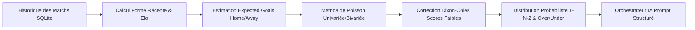

# BETSOCCER — PROPOSITION D'ARCHITECTURE CIBLE (PHASE 0)

**Date d'audit :** 13 Octobre 2026  
**Auteur :** Architecte Logiciel Senior Flutter/Dart & Spécialiste IA  
**Projet :** BETSOCCER — Multisport Analytics AI  
**Statut :** SPÉCIFICATION ARCHITECTURALE VALIDÉE

---

## 1. PRINCIPES DIRECTEURS DU SYSTÈME

L'architecture de BETSOCCER repose sur cinq principes fondamentaux :
1. **Clean Architecture & Feature-First :** Découplage strict entre la présentation (Flutter), le domaine métier (Dart pur indépendant de Flutter) et l'infrastructure de données.
2. **Offline-First Déterministe :** L'application est autonome. Les prédictions et statistiques résultent d'un moteur algorithmique mathématique rigoureusement déterministe s'exécutant en local dans des `Isolates` Dart.
3. **IA Contrainte et Non-Génératrice de Cotes :** Les modèles de langage (LLM) ne calculent jamais les probabilités et n'inventent aucun chiffre. Ils reçoivent les données statistiques vérifiées et produisent une analyse textuelle explicative au format JSON strict.
4. **Extensibilité Multi-Sports :** Modèle abstrait `Sport` permettant d'ajouter de nouveaux sports (Basketball, Tennis, Rugby) par polymorphisme sans refondre l'application.
5. **Conformité des Identifiants & Normes :**
   - Application ID / Package Name obligatoire : `com.ghdinteractivestudio.betsoccer` (Directive `/root/AGENTS.md`).
   - Mises à jour OTA conformes aux standards de sécurité v1.0.11.

---

## 2. STRUCTURE GLOBALE DU PROJET

L'arborescence cible dans `/root/BETSOCCER` adopte une organisation modulaire par fonctionnalités :

```
/root/BETSOCCER/
├── android/                        # Configuration native Android (namespace: com.ghdinteractivestudio.betsoccer)
├── assets/                         # Données statiques
│   ├── data/historical/            # Fichiers openfootball CC0 pré-embarqués (Premier League, etc.)
│   └── icons/                      # Logos et icônes vectorielles originaux
├── docs/                           # Documentation
│   └── phase-0/                    # Livrables d'audit et de validation Phase 0
├── lib/
│   ├── app.dart                    # Racine de l'application Flutter (Thème, routes)
│   ├── main.dart                   # Point d'entrée principal (Initialisation SQLite et DI)
│   ├── core/                       # Composants partagés transverses
│   │   ├── constants/              # Constantes d'API, clés de configuration, métriques
│   │   ├── database/               # Implémentation Drift SQLite (tables, migrations, DAOs)
│   │   ├── errors/                 # Gestion des exceptions et Failures typées
│   │   ├── network/                # Client Dio, intercepteurs, rate-limiter et politique de retry
│   │   ├── theme/                  # Tokens de design, typographie, modes sombre/clair
│   │   └── utils/                  # Formateurs de dates, conversions d'unités
│   └── features/                   # Découpage modulaire Feature-First
│       ├── sports/                 # GESTION DES MATCHS, LIGUES ET RÉSULTATS
│       │   ├── domain/             # Entités pures : Sport, Match, Team, Competition, Standing
│       │   ├── data/               # SportsRepository, connecteurs SQLite, OpenFootball, TheSportsDB
│       │   └── presentation/       # Écrans D1 (Live), D2 (À venir), D3 (Historique)
│       ├── analytics/              # MOTEUR STATISTIQUE DÉTERMINISTE
│       │   ├── domain/
│       │   │   ├── engines/        # Calculs purs : PoissonEngine, DixonColesEngine, EloEngine
│       │   │   └── models/         # Probabilities, ExpectedGoals, BrierScore, FormIndex
│       │   ├── data/               # AnalyticsRepository, mise en cache des calculs matriciels
│       │   └── presentation/       # Écran D4 (Cartes de probabilités, graphiques de forme)
│       └── ai_assistant/           # ORCHESTRATION ET EXPLICATION IA
│           ├── domain/
│           │   ├── interfaces/     # AiProviderInterface (Abstrait multi-fournisseurs)
│           │   ├── models/         # AiPromptPayload, AiExplanationResponse (JSON structuré)
│           │   └── services/       # AiOrchestrator (Génération des prompts contraints)
│           ├── data/
│           │   └── providers/      # OpenRouterAiProvider, MockAiProvider (Fallback local)
│           └── presentation/       # Écran D5 (Composant d'explication IA, dialogue interactif)
└── test/                           # SUITE DE TESTS AUTOMATISÉS
    ├── core/                       # Tests de base de données in-memory et réseau
    ├── features/analytics/         # Tests unitaires mathématiques (Poisson, Dixon-Coles, Elo)
    └── features/sports/            # Tests des repositories et de l'intégrité temporelle
```

---

## 3. LE MOTEUR STATISTIQUE DÉTERMINISTE (FEATURE ANALYTICS)

Le domaine statistique (`features/analytics/domain/engines/`) est complètement isolé du framework Flutter et s'exécute de façon déterministe.



### Algorithmes intégrés :
1. **Loi de Poisson Bivariée :**
   $$\lambda_{dom} = \text{Att}_{dom} \times \text{Def}_{ext} \times \gamma_{domaine}$$
   $$\mu_{ext} = \text{Att}_{ext} \times \text{Def}_{dom}$$
   Calcul de la probabilité d'un score $(x, y)$ :
   $$P(X=x, Y=y) = \frac{\lambda^x e^{-\lambda}}{x!} \times \frac{\mu^y e^{-\mu}}{y!}$$
2. **Ajustement Dixon-Coles :**
   Correction de corrélation pour les scores fréquents à faible nombre de buts $(0-0, 1-0, 0-1, 1-1)$ via le paramètre de dépendance $\rho$.
3. **Notation Elo Dynamique :**
   Mise à jour incrémentale de la puissance des équipes après chaque rencontre, tenant compte de la marge de victoire et de l'avantage du terrain.
4. **Pondération Temporelle de la Forme :**
   Pondération exponentielle décroissante des $N$ derniers matchs ($w_k = e^{-\xi \Delta t}$).

---

## 4. SERVICE D'ORCHESTRATION IA (FEATURE AI_ASSISTANT)

L'orchestrateur IA (`AiOrchestrator`) applique un patron de conception *Strategy* avec contrat strict :

```dart
abstract interface class AiProviderInterface {
  Future<AiExplanationResponse> generateExplanation({
    required AiPromptPayload payload,
  });
}
```

### Règles de garde contre les hallucinations :
1. **Payload d'entrée verrouillé :** Le prompt système transmet explicitement les valeurs déjà calculées par le moteur statistique :
   ```json
   {
     "home_team": "Arsenal",
     "away_team": "Chelsea",
     "calculated_win_prob_home": 0.58,
     "calculated_draw_prob": 0.24,
     "calculated_win_prob_away": 0.18,
     "expected_goals_home": 1.95,
     "expected_goals_away": 0.85
   }
   ```
2. **Consigne d'inviolabilité :** « Vous êtes un analyste sportif objectif. Vous ne devez en aucun cas recalculer ou modifier les probabilités fournies. Votre rôle est d'expliquer textuellement en 3 points clés les facteurs ayant conduit à ce profil statistique. »
3. **Sortie JSON stricte :** Validation du schéma de réponse via `response_format: {"type": "json_object"}`.

---

## 5. MODÈLE DE DONNÉES LOCAL SQLITE (DRIFT)

Le schéma relationnel est conçu pour une efficacité maximale en lecture et pour le backtesting historique :

- **`sports`** : `id`, `name`, `code`, `icon_ref`.
- **`competitions`** : `id`, `sport_id`, `name`, `country_code`, `tier`, `active_season`.
- **`teams`** : `id`, `sport_id`, `name`, `short_name`, `badge_url`, `elo_rating`.
- **`matches`** : `id`, `competition_id`, `home_team_id`, `away_team_id`, `utc_kickoff`, `status`, `home_score`, `away_score`, `raw_events_json`, `last_synced_at`.
- **`statistical_predictions`** : `id`, `match_id`, `model_type`, `home_win_prob`, `draw_prob`, `away_win_prob`, `lambda_home`, `mu_away`, `brier_score`, `created_at`.
- **`ai_analyses`** : `id`, `match_id`, `model_id`, `explanation_json`, `created_at`.

---

## 6. CONCLUSION DE L'ÉTAPE G

L'architecture proposée est parfaitement équilibrée : autonome, modulaire, extensible à d'autres sports, totalement gratuite à l'usage, et hermétique aux dérives de calculs erratiques grâce à son moteur déterministe sous contrôle.
