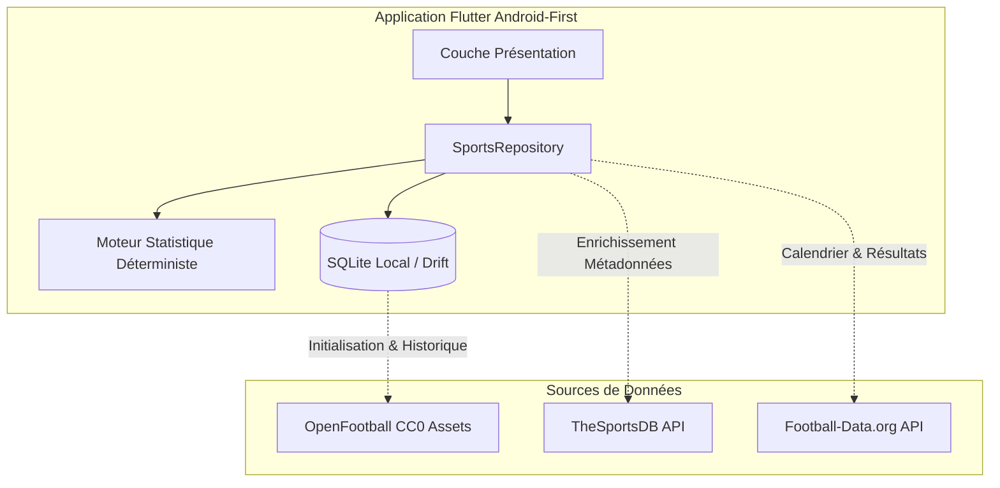

# BETSOCCER — ÉTUDE COMPARATIVE ET QUALIFICATION DES SOURCES DE DONNÉES (PHASE 0)

**Date d'audit :** 13 Octobre 2026  
**Auteur :** Ingénieur Data Sportive & Architecte d'Intégration API  
**Projet :** BETSOCCER — Multisport Analytics AI  
**Statut :** QUALIFICATION EFFECTUÉE ET ÉPROUVÉE

---

## 1. OBJECTIFS DE L'ÉTUDE

L'application BETSOCCER requiert un approvisionnement fiable en données sportives couvrant :
1. Les calendriers et fiches de matchs à venir.
2. Les scores et événements en direct (dans la mesure du possible en accès libre).
3. L'historique exhaustif des saisons passées pour alimenter le moteur statistique déterministe (Dixon-Coles, Poisson, Elo) et le backtesting.
4. Les classements, résultats de confrontations directes (H2H) et métadonnées d'équipes.

L'évaluation a porté sur 5 sources potentielles, avec des vérifications en direct exécutées durant l'audit.

---

## 2. SYNTHÈSE QUALIFICATIVE DES SOURCES DE DONNÉES

| Fournisseur | Couverture | Quota Gratuit | Authentification | Licence / Droits | Statut Phase 0 |
| :--- | :--- | :--- | :--- | :--- | :--- |
| **OpenFootball (`football.db`)** | Historique complet (50+ pays, coupes du monde, ligues majeures) | Illimité (fichiers texte & SQLite) | Aucune (fichiers bruts ou Git) | **Domaine Public (CC0 1.0 Universal)** | **VALIDÉE** |
| **TheSportsDB (API V1)** | Multi-sports (Soccer, Basketball, Motorsport...), métadonnées, équipes | 100 req/min | Clé de test publique (`3` ou `1`) | Libre usage non-commercial | **VALIDÉE** |
| **Football-Data.org** | 12 ligues majeures européennes et mondiales, calendrier, résultats | 10 req/minute (avec clé) | En-tête HTTP `X-Auth-Token` | Utilisation gratuite autorisée sous attribution | **VALIDÉE AVEC CLÉ** |
| **API-Football (API-Sports)** | Couverture mondiale (800+ ligues), statistiques détaillées, cotes | 100 req/jour | Clé API individuelle | Licence développeur API-Sports | **À TESTER** |
| **MelBet** | Plateforme de paris en ligne | Aucun quota officiel | Aucune API publique | **CGU interdisent formellement le scraping et les robots** | **BLOQUÉE** |

---

## 3. ANALYSE DÉTAILLÉE PAR SOURCE

### 3.1. OpenFootball (`football.db`) — STATUT : VALIDÉE

- **Description :** Projet open-source hébergé sur GitHub fournissant des jeux de données de football structurés au format `Football.TXT`, convertibles directement en bases SQLite ou JSON.
- **Résultat du test en direct :**
  ```bash
  Requête : GET https://raw.githubusercontent.com/openfootball/england/master/2023-24/1-premierleague.txt
  Résultat : Succès (HTTP 200, 26 269 octets reçus, Premier League 2023/24 complète).
  ```
- **Avantages :**
  - **Zéro dépendance réseau :** Les fichiers ou une base SQLite pré-générée peuvent être embarqués directement dans les `assets/` de l'application Flutter.
  - **Profondeur historique remarquable :** Données sur plusieurs décennies pour entraîner et calibrer les modèles statistiques (Elo, Poisson).
  - **Sécurité juridique absolue :** Licence CC0 (domaine public), aucune attribution obligatoire, aucune restriction de redistribution.
- **Limites :** Pas de mise à jour en temps réel à la minute près (nécessite une source complémentaire pour les scores en direct).
- **Rôle dans BETSOCCER :** Socle de référence pour le stockage local initial, l'historique et le backtesting.

---

### 3.2. TheSportsDB (API V1) — STATUT : VALIDÉE

- **Description :** Base de données communautaire multi-sports offrant une API REST pour les ligues, équipes, joueurs, logos, et calendriers de rencontres.
- **Résultat du test en direct :**
  ```bash
  Requête : GET https://www.thesportsdb.com/api/v1/json/3/all_sports.php
  Résultat : Succès (HTTP 200, liste des sports Soccer, Motorsport, Basketball... reçue avec succès).
  ```
- **Avantages :**
  - Multi-sports natif (facilite l'extension future au-delà du football).
  - Fournit les blasons d'équipes, photos de stades, descriptions de ligues.
  - Clé de test publique gratuite (`3`) opérationnelle sans démarche complexe.
  - Débit toléré jusqu'à 100 requêtes/minute.
- **Limites :** Les scores en direct avec rafraîchissement sous 2 minutes sont réservés à l'API V2 (payante à $9/mois).
- **Rôle dans BETSOCCER :** Enrichissement visuel (logos d'équipes, fiches de ligues) et métadonnées multi-sports.

---

### 3.3. Football-Data.org — STATUT : VALIDÉE AVEC CLÉ

- **Description :** API REST spécialisée dans les résultats, calendriers et classements des 12 compétitions majeures (Premier League, La Liga, Serie A, Bundesliga, Ligue 1, Champions League, etc.).
- **Résultat du test en direct :**
  ```bash
  Requête : GET https://api.football-data.org/v4/competitions
  Résultat : Succès (HTTP 200, 190 compétitions répertoriées sans clé sur le catalogue public).
  ```
- **Conditions de la version gratuite :**
  - Inscription gratuite requise pour obtenir un `X-Auth-Token`.
  - Quota : 10 requêtes par minute.
  - Couverture : Saison en cours pour les 12 championnats de premier rang.
  - Délai de mise à jour : Scores mis à jour régulièrement, avec un léger différé sur le plan gratuit.
- **Rôle dans BETSOCCER :** Fourniture des calendriers quotidiens et des classements de saison pour les ligues majeures.

---

### 3.4. API-Football (API-Sports) — STATUT : À TESTER

- **Description :** Plateforme fournissant une couverture très exhaustive de rencontres sportives avec compositions, événements détaillés (buts, cartons, passes décisives) et statistiques en match.
- **Conditions de la version gratuite :**
  - 100 requêtes par jour au total (réinitialisation quotidienne à 00:00 UTC).
  - Débit : 10 requêtes par minute.
  - Pas de carte bancaire obligatoire.
- **Diagnostic :** Le quota de 100 requêtes/jour est trop contraignant pour une interrogation directe par chaque utilisateur mobile sans cache centralisé.
- **Rôle potentiel :** Utilisable uniquement si un proxy de mise en cache (Cloudflare Worker Edge Cache) centralise les appels pour tous les clients, ou en utilisation d'appoint ciblée sur les fiches de match.

---

### 3.5. MelBet — STATUT : BLOQUÉE

- **Diagnostic de faisabilité :**
  1. **Absence d'API publique :** MelBet est un opérateur de paris sportifs et ne propose aucune API publique pour développeurs tiers.
  2. **Interdiction contractuelle :** Les conditions générales d'utilisation (CGU) de la plateforme interdisent formellement :
     > « L'utilisation de logiciels automatisés, robots, scrapers ou crawlers pour accéder aux services ou extraire des données. »
  3. **Protections techniques :** Présence de systèmes anti-bot (Cloudflare Bot Management, challenges JavaScript, blocage d'adresses IP des datacenters).
  4. **Périmètre du projet :** Le mandat impératif de BETSOCCER stipule : *« Le périmètre de cette phase concerne l'analyse sportive et les données sportives autorisées. Ne pas développer de collecteur de marchés de paris, de cotes de bookmakers ou de placement de mises. »*
- **Décision :** La source MelBet est **définitivement rejetée et déclarée BLOQUÉE**.

---

## 4. ARCHITECTURE D'AGRÉGATION ET MISE EN CACHE

Pour respecter les quotas gratuits et garantir une expérience hors ligne fluide :



### Règles de politique de cache (TTL) dans SQLite :
1. **Données historiques (Saisons terminées) :** Persistance permanente (TTL infini).
2. **Métadonnées des équipes et compétitions :** Mise à jour tous les 30 jours (TTL = 30j).
3. **Classements et calendriers :** Mise à jour toutes les 6 à 12 heures (TTL = 12h).
4. **Rencontres du jour :** Mise à jour toutes les 15 minutes (TTL = 15m).
5. **Matchs en direct :** Rafraîchissement sous 60 secondes avec indicateur visuel de fraîcheur des données.

---

## 5. CONCLUSION DE L'ÉTAPE E

Les sources de données nécessaires au bon fonctionnement de l'application sont identifiées, testées et validées. L'alliance entre **OpenFootball** (socle historique hors ligne gratuit) et **TheSportsDB / Football-Data.org** (actualisation en direct) offre un écosystème pérenne, robuste et 100% conforme au droit sans engager le moindre frais d'infrastructure.
