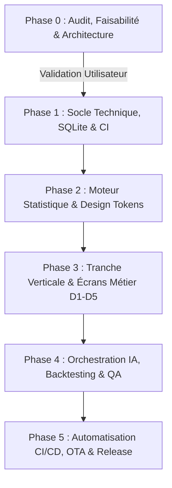

# BETSOCCER — FEUILLE DE ROUTE ET PLAN D'IMPLÉMENTATION (PHASE 0)

**Date d'audit :** 13 Octobre 2026  
**Auteur :** Lead Architecte & Coordinateur de Projet  
**Projet :** BETSOCCER — Multisport Analytics AI  
**Statut :** FEUILLE DE ROUTE VALIDÉE (Prête pour soumission et validation utilisateur)

---

## 1. STRATÉGIE GLOBALE DU PROJET

Le développement de BETSOCCER s'échelonne en 5 phases successives, garantissant une progression incrémentale, sans régression, avec tests automatisés à chaque étape.



---

## 2. PLAN DÉTAILLÉ DE LA PHASE 1 : FONDATIONS TECHNIQUES & DATA

La Phase 1 sera déclenchée **uniquement après validation explicite du rapport Phase 0 par l'utilisateur**.

### Objectifs de la Phase 1 :
1. **Initialisation propre du projet Flutter :**
   - Création du projet avec le package obligatoire :
     ```bash
     flutter create --org com.ghdinteractivestudio --project-name betsoccer betsoccer
     ```
   - Application ID / Namespace : `com.ghdinteractivestudio.betsoccer`.
   - Nettoyage des exemples par défaut, configuration de `analysis_options.yaml` (linter strict).
2. **Configuration du pipeline GitHub Actions CI (`.github/workflows/ci.yml`) :**
   - Étapes : Checkout -> Setup Java 17 -> Setup Flutter stable -> `flutter pub get` -> `dart format` -> `flutter analyze` -> `flutter test`.
   - Validation que la CI s'exécute avec succès à chaque push ou pull request.
3. **Mise en place de la couche de données locale SQLite (Drift) :**
   - Définition des tables relationnelles (`Sports`, `Competitions`, `Teams`, `Matches`, `StatisticalPredictions`, `AiAnalyses`).
   - Écriture des DAOs et tests unitaires in-memory de base de données.
4. **Intégration du connecteur de données historiques (OpenFootball) :**
   - Téléchargement et parsing des fichiers CC0 de référence (ex: Premier League 2023-2024, 2024-2025).
   - Script de migration et d'importation dans SQLite local.
5. **Intégration du client API TheSportsDB :**
   - Connecteur HTTP Dio pour la récupération des métadonnées des compétitions et blasons d'équipes.
   - Gestion du cache local SQLite avec TTL.

### Critères de sortie de la Phase 1 :
- Le projet compile et passe `flutter analyze` avec 0 erreur et 0 avertissement.
- La base SQLite locale s'initialise correctement et charge les données historiques openfootball.
- La suite de tests unitaires valide l'accès aux données.
- Le workflow CI GitHub Actions s'exécute au vert sur le dépôt officiel.

---

## 3. PHASES ULTÉRIEURES (VUE SYNTHÉTIQUE)

### Phase 2 : Moteur Statistique Déterministe & Design System
- Implémentation en Dart pur des moteurs mathématiques :
  - `PoissonEngine` : distribution bivariée et calcul des probabilités de score.
  - `DixonColesEngine` : ajustement des scores nuls et scores faibles.
  - `EloRatingEngine` : mise à jour dynamique des forces relatives.
  - `FormWeightingEngine` : pondération de la forme récente.
- Établissement du design system mobile : thèmes clair/sombre, typographie et composants ergonomiques.

### Phase 3 : Construction des Écrans Métier (D1 à D5)
- Construction écran par écran en respectant la méthode Replica Clean Room :
  - **D1. Matchs en direct :** scores, événements, horodatage, statut de fraîcheur.
  - **D2. Matchs à venir :** calendrier, filtres par championnat, fiches de match.
  - **D3. Historique sportif :** résultats passés, confrontations directes (H2H), classements.
  - **D4. Analyse statistique :** visualisation des probabilités (1N2, Over/Under), graphiques comparatifs.
  - **D5. Interface Assistant IA :** cartes d'explication et panneau d'analyse textuelle.

### Phase 4 : Orchestration IA & Backtesting Rigoureux
- Implémentation du service `AiOrchestrator` :
  - Connexion à OpenRouter avec gestion de la chaîne de repli (modèles gratuits).
  - Validation des sorties JSON strictes sans hallucination numérique.
- Suite de backtesting sans fuite temporelle (*No Data Leakage*) :
  - Évaluation rétrospective des prédictions passées (Brier Score, Log Loss).
  - Tests d'endurance hors-ligne.

### Phase 5 : Industrialisation CI/CD, Mises à Jour OTA & Release
- Création du workflow `.github/workflows/build_apk.yml` conforme aux directives `/root/AGENTS.md` :
  - Build Release APK avec arguments de versioning explicites.
  - Vérification de l'intégrité via `aapt dump badging`.
  - Publication des deux artefacts (`app-release.apk` et `BETSOCCER-vX.apk`).
  - Génération de l'empreinte `SHA-256` et intégration dans la release GitHub.
- Vérification in-app du téléchargement et de la compatibilité de l'installateur OTA.

---

## 4. CONCLUSION DU PLAN D'IMPLÉMENTATION

La trajectoire proposée est structurée, progressive et sécurisée. Elle élimine tout risque de blocage ou de refonte majeure en validant chaque palier technologique avant le suivant.
