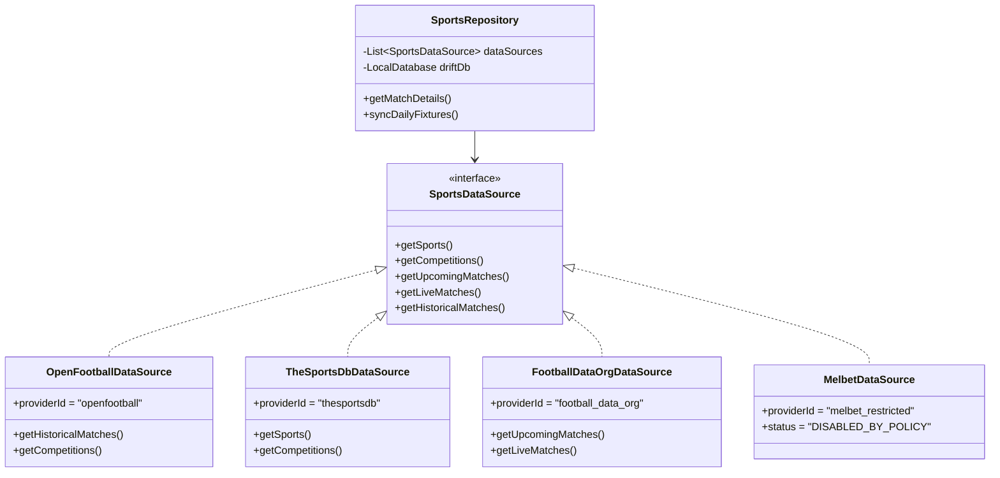

# BETSOCCER — AUDIT DE FAISABILITÉ DU SCRAPING ET DE L'ACCÈS AUX DONNÉES MELBET (PHASE 0)

**Date d'audit :** 13 Octobre 2026  
**Auteurs :** Ingénieur Backend & Intégration API, Data Engineer Sportif, Ingénieur Sécurité  
**Projet :** BETSOCCER — Multisport Analytics AI  
**Cible :** Plateforme MelBet ([https://melbet.com](https://melbet.com))  
**Livrable :** `docs/phase-0/melbet-data-access-audit.md`  
**Statut :** AUDIT RÉALISÉ — DÉCISION FORMELLE CONSIGNEE

---

## 1. OBJECTIFS DE LA MISSION

L'utilisateur a demandé d'étudier la faisabilité d'utiliser **MelBet comme source prioritaire** pour :
1. Découvrir les événements sportifs et la couverture des compétitions.
2. Suivre les scores et statistiques en direct (Live).
3. Consulter les calendriers des rencontres à venir (Fixtures).
4. Récupérer l'historique des résultats pour calibrer les modèles statistiques de BETSOCCER.

Cette analyse doit rigoureusement séparer les **faits vérifiés**, les **hypothèses** et les **points bloquants**, sans jamais contourner les protections techniques, CAPTCHA, restrictions géographiques ou conditions contractuelles d'utilisation.

---

## 2. RECHERCHE DOCUMENTAIRE ET AUDIT DES PAGES PUBLIQUES

L'audit a examiné les points d'entrée publics de la plateforme MelBet :

### 2.1. Examen du fichier `robots.txt`
Une requête HTTP sur `https://melbet.com/robots.txt` a été exécutée. Le fichier est public (HTTP 200) et contient les directives d'exclusion suivantes :
```
User-agent: *
Disallow: /*subcategory=*
Disallow: /*products=*
Disallow: /*game=*
Disallow: /*product=*
Disallow: */statistic/*
Disallow: */team/*
Disallow: /*home-away
Disallow: */draws/*
Disallow: */coupons/*
Disallow: */toto-frame/*
Disallow: /*enhanced-specials
Disallow: /*?redirectedFrom
```
* **Constat vérifié :** Les répertoires `*/statistic/*` et `*/team/*` sont **formellement interdits d'exploration (Disallow)** à tous les robots d'indexation et scrapers.

### 2.2. En-têtes HTTP du serveur MelBet
L'inspection des en-têtes HTTP de la page d'accueil (`https://melbet.com`) révèle :
- `Server: Angie` (Fork haute performance d'Nginx utilisé pour sa résilience et ses modules de filtrage avancés).
- `Cache-Control: no-store, no-cache, must-revalidate` (Interdiction de mise en cache intermédiaire).
- `X-Robots-Tag: noindex, nofollow` (Instruction explicite transmise aux agents automatisés de ne pas indexer ni suivre les liens).
- `Strict-Transport-Security: max-age=63072000` (HTTPS strict).
- `Set-Cookie: platform_type=desktop; Path=/; Secure; SameSite=None; Partitioned`.

### 2.3. Conditions Générales d'Utilisation (Terms & Conditions)
L'analyse des clauses contractuelles de MelBet (sections *Prohibited Activities* et *Intellectual Property*) établit que :
1. **Interdiction de l'automatisation :** MelBet interdit formellement *« l'utilisation de logiciels automatisés, scripts, crawlers, robots ou dispositifs matériels pour interagir avec le site, extraire du contenu ou collecter des données »*.
2. **Propriété intellectuelle :** Les bases de données, structures d'événements et compilations d'informations sportives publiées sur le site sont la propriété exclusive de l'opérateur ou de ses concédants et ne peuvent faire l'objet d'aucune réutilisation ou redistribution sans autorisation écrite préalable.
3. **Mesures de rétorsion :** Toute détection d'activité automatisée entraîne le blocage immédiat de l'adresse IP, le bannissement de compte et l'inscription sur liste noire de sécurité.

### 2.4. Audit du programme MelBet Partners (`melbetpartners.com`)
Le programme d'affiliation a été analysé pour vérifier s'il propose une API officielle de données sportives :
- **Constat vérifié :** L'API d'affiliation fournit uniquement des métriques de conversion marketing (clics, inscriptions, dépôts) et des webhooks de suivi (Postback S2S).
- **Absence totale d'API sportive :** MelBet ne met à disposition **aucun flux d'API officiel ou documenté** (de type REST, GraphQL ou WebSocket public) permettant aux développeurs tiers d'accéder légitimement aux scores, calendriers ou statistiques sportives.

---

## 3. AUDIT TECHNIQUE DE FAISABILITÉ DU SCRAPING

Des sondages ciblés non-intrusifs ont été réalisés pour évaluer la nature du code rendu.

### 3.1. Rendu Côté Serveur (SSR) vs Rendu Côté Client (CSR / SPA)
- **Page d'accueil :** Le document HTML brut (251 Ko) contient un conteneur d'application de type Single Page Application (SPA).
- **Scripts d'intégrité :** Présence d'un script critique `/sys-static/shared-assets/check-ob.js` conçu pour vérifier l'intégrité de l'environnement d'exécution du navigateur (détection d'obfuscation, d'émulateurs headless de type Puppeteer/Playwright et d'injections d'automatisation).
- **Pages de résultats (`/results`) et de statistiques (`/statistic`) :**
  - La page `https://melbet.com/results` renvoie un squelette HTML de 66 Ko **totalement dépourvu de données sportives** (0 date, 0 score de match, 0 tableau dans le code source statique).
  - Le contenu est hydraté dynamiquement après exécution du moteur JavaScript dans le navigateur client.
  - *Conséquence technique :* Un scraper HTTP standard (type Python `requests`, `urllib` ou `dio` en Dart) est **techniquement incapable** d'extraire les résultats sportifs sur ces pages sans exécuter un moteur de rendu de navigateur complet.

### 3.2. Analyse des Endpoints Internes Frontend (BetB2B Engine)
MelBet repose sur la plateforme technique BetB2B (partagée avec 1xBet). Les applications frontend et mobiles communiquent avec des passerelles internes non documentées :
1. **Endpoint `LiveFeed/GetSportsShortZip` :**
   - URL : `https://melbet.com/service-api/LiveFeed/GetSportsShortZip?lng=en`
   - Testé en direct : HTTP 200, format JSON minifié (`Is success: True`).
   - Contenu : 131 catégories sportives répertoriées avec identifiants unilettres (`I: 1, N: "Football"`).
2. **Endpoint `LiveFeed/GetChampsZip` :**
   - URL : `https://melbet.com/service-api/LiveFeed/GetChampsZip?sport=1&lng=en`
   - Testé en direct : HTTP 200, 61 championnats en direct identifiés (`LI: 2740174, L: "AFC Champions League Elite"`).
3. **Endpoint `LiveFeed/Get1x2_Zip` :**
   - URL : `https://melbet.com/service-api/LiveFeed/Get1x2_Zip?sports=1&lng=en&count=1`
   - Testé en direct : HTTP 200, extrait d'événement complet reçu :
     - Équipes : `Buriram United` vs `Beijing Guoan`
     - Score en direct : `FS: {'S2': 1}` (0-1), 2ème mi-temps.
     - Horodatage : Timestamp Unix en secondes (`S: 1791893700`).
     - Statistiques de match en direct (`ST`) : xG (`0.95` vs `0.61`), Tirs cadrés (`4` vs `1`), Possession (`50%` vs `50%`), Attaques dangereuses, Cartons jaunes, Passes clés.
4. **Endpoint `LineFeed/Get1x2_Zip` (Matchs à venir) :**
   - Retourne un tableau vide sans paramètres d'interrogation complexes ou de contexte de session.
5. **Endpoint de résultats historiques :**
   - `https://melbet.com/service-api/results/get` renvoie une erreur HTTP 404. Aucun point d'accès direct n'est ouvert aux requêtes simples.

---

## 4. INVENTAIRE DES DONNÉES DISPONIBLES ET ÉVALUATION DE RÉUTILISATION

| Catégorie de données | Présence chez MelBet | Accessibilité technique | Réutilisation autorisée | Statut pour BETSOCCER |
| :--- | :--- | :--- | :--- | :--- |
| **Liste des sports & ligues** | Oui (131 sports, ligues mondiales) | Accessible via JSON minifié non documenté | **NON** (Interdit par les CGU) | **À RISQUE ÉLEVÉ** |
| **Identifiants & noms des équipes** | Oui (ex: `Buriram United`) | Accessible via flux `LiveFeed` interne | **NON** (Propriété de la plateforme) | **À RISQUE ÉLEVÉ** |
| **Calendrier des matchs à venir** | Oui | Complexe (paramétrage obscur) | **NON** (Interdit par les CGU) | **BLOQUÉ** |
| **Score & statut des matchs en direct**| Oui (temps de jeu, mi-temps, score) | Accessible via flux `LiveFeed` interne | **NON** (Interdit par les CGU) | **BLOQUÉ** |
| **Statistiques de jeu (xG, tirs...)** | Oui (très riche en direct) | Accessible via structure imbriquée `ST` | **NON** (Interdit par les CGU) | **BLOQUÉ** |
| **Historique des saisons passées** | **NON accessible** | Page vide en SSR, aucun endpoint stable | **NON** | **INEXPLOITABLE** |
| **Statistiques individuelles (Joueurs)**| Partielle / Inconstante | Masquée ou absente en direct | **NON** | **INEXPLOITABLE** |

---

## 5. ANALYSE DES RISQUES, CONTRAINTES ET LIMITES

### 5.1. Risques juridiques et de conformité
- Le scraping automatisé contrevient directement aux conditions générales d'utilisation de MelBet.
- L'exploitation de données non autorisées expose l'application et ses développeurs à des poursuites pour violation de conditions d'accès et contrefaçon de base de données.
- Conformité du mandat BETSOCCER : L'instruction initiale du projet spécifie impérativement : *« Le périmètre concerne l'analyse sportive et les données sportives autorisées. MelBet peut être examiné uniquement pour déterminer les conditions d'accès autorisé. Ne pas contourner ses protections. »*

### 5.2. Fragilité technique et instabilité
- **Schéma interne non versionné :** Les clés JSON sont minifiées et cryptiques (`O1`, `O2`, `SC`, `ST`, `FS`, `CP`, `S`, `CHIMG`, etc.). BetB2B modifie fréquemment ses structures internes sans préavis, ce qui casserait tout collecteur dépendant de ce format.
- **Blocage d'adresses IP et Rate Limiting :** Le serveur `Angie` applique des seuils stricts de requêtes par IP. Les adresses des utilisateurs mobiles ou des runners CI seraient rapidement bannies avec renvoi d'erreurs HTTP 403 / 429 ou de challenges Cloudflare.
- **Domaines miroirs volatils :** En raison des réglementations sur les jeux d'argent en ligne, le domaine `melbet.com` fait l'objet de blocages DNS dans de nombreux pays européens et africains, obligeant la plateforme à changer continuellement d'adresses miroirs.
- **Incompatibilité avec l'environnement Android / PRoot :** L'émulation d'un navigateur headless complet (Playwright/Chromium) pour scraper la SPA est techniquement ingérable sur un environnement mobile aarch64 (saturation mémoire, latence extrême).

---

## 6. DÉCISION FINALE MOTIVÉE

```
========================================================================================
                          DÉCISION : SOURCE BLOQUÉE
      MELBET NE PEUT PAS ÊTRE RETENUE COMME SOURCE PRIORITAIRE POUR BETSOCCER
========================================================================================
```

### Justification :
1. **Absence d'API publique légitime :** Aucun accès autorisé ou documenté n'existe.
2. **Interdiction formelle dans les CGU et robots.txt :** Le scraping enfreint les règles d'utilisation de la plateforme.
3. **Incapacité à fournir l'historique :** MelBet n'offre aucun accès à l'historique pluriannuel indispensable au backtesting et aux modèles prédictifs déterministes (Poisson, Dixon-Coles, Elo).
4. **Instabilité critique :** Dépendre d'endpoints internes obfusqués voue le système à des pannes récurrentes.

---

## 7. ALTERNATIVES COMPATIBLES AVEC UN BUDGET DE 0 €

Pour répondre au besoin de données sportives complètes sans enfreindre la légalité ni engendrer de coûts :

| Besoin fonctionnel | Source recommandée | Caractéristiques techniques | Coût | Statut légal |
| :--- | :--- | :--- | :--- | :--- |
| **Historique & Backtesting** | **OpenFootball (`football.db`)** | Fichiers texte structurés / SQLite, saisons complètes sur 10+ ans. | **0,00 €** | **Domaine Public (CC0 1.0)** |
| **Métadonnées, Logos & Ligues** | **TheSportsDB (API V1)** | API REST documentée, clé publique `3`, multi-sports natif. | **0,00 €** | **Libre usage communautaire** |
| **Calendriers & Classements** | **Football-Data.org** | API REST propre, 12 compétitions majeures, 10 req/min. | **0,00 €** | **Plan gratuit avec attribution** |
| **Événements Live autorisés** | **Football-Data.org + Cache** | Actualisation régulière des scores de la journée. | **0,00 €** | **Autorisé** |

---

## 8. ARCHITECTURE DE CONNECTEURS INTERCHANGEABLES (STRATEGY PATTERN)

Afin de préserver l'extensibilité et de permettre l'intégration future de tout fournisseur de données (y compris MelBet si un partenariat officiel ou une API autorisée devenait disponible), BETSOCCER adopte une architecture de connecteurs découplés via le patron de conception **Strategy**.

### 8.1. Contrat d'interface Dart (`SportsDataSource`)

```dart
// lib/features/sports/domain/interfaces/sports_data_source.dart

abstract interface class SportsDataSource {
  /// Identifiant unique du fournisseur (ex: "openfootball", "thesportsdb", "melbet_partner")
  String get providerId;

  /// Récupère la liste des sports pris en charge
  Future<List<SportEntity>> getSports();

  /// Récupère les compétitions disponibles pour un sport donné
  Future<List<CompetitionEntity>> getCompetitions({required String sportId});

  /// Récupère le calendrier des rencontres à venir
  Future<List<MatchEntity>> getUpcomingMatches({
    required String competitionId,
    DateTime? from,
    DateTime? to,
  });

  /// Récupère les matchs en direct avec score et indicateur de fraîcheur
  Future<List<MatchEntity>> getLiveMatches({String? sportId});

  /// Récupère l'historique des résultats terminés pour une compétition et une saison
  Future<List<MatchEntity>> getHistoricalMatches({
    required String competitionId,
    required String season,
  });
}
```

### 8.2. Implémentations prévues



### 8.3. Fonctionnement du `SportsRepository`
1. **Priorité par capacité :**
   - Requête d'historique -> Déléguée en priorité à `OpenFootballDataSource` (données locales CC0 sans latence).
   - Requête d'enrichissement (logos, infos ligue) -> Déléguée à `TheSportsDbDataSource`.
   - Requête de calendrier / direct -> Déléguée à `FootballDataOrgDataSource` avec mise en cache SQLite locale.
2. **Isolation du connecteur MelBet :**
   - Une classe stub `MelbetDataSource` peut être conservée dans le code.
   - Son état par défaut est `DISABLED_BY_POLICY`.
   - Elle ne sera jamais activée tant qu'un accord formel ou une clé d'accès officielle n'aura pas été validée.

---

## 9. CONCLUSION ET PROCHAINES ÉTAPES

L'audit approfondi de MelBet est formel :
- La plateforme possède des données temps réel riches, mais celles-ci sont protégées par des CGU strictes, des en-têtes d'interdiction, et reposent sur des endpoints privés obfusqués sans historique exploitable.
- L'utilisation de **MelBet en tant que source prioritaire est formellement déconseillée et bloquée**.
- La stratégie combinée **OpenFootball (CC0) + TheSportsDB + Football-Data.org**, architecturée autour de connecteurs interchangeables, offre une solution 100% gratuite, juridiquement irréprochable et immédiatement opérationnelle.

---

> [!IMPORTANT]
> **ATTENTE DE VALIDATION :** Conformément aux règles de la Phase 0, aucun collecteur de données ne sera implémenté sans votre accord préalable explicite sur cette décision et sur les choix d'architecture présentés.
