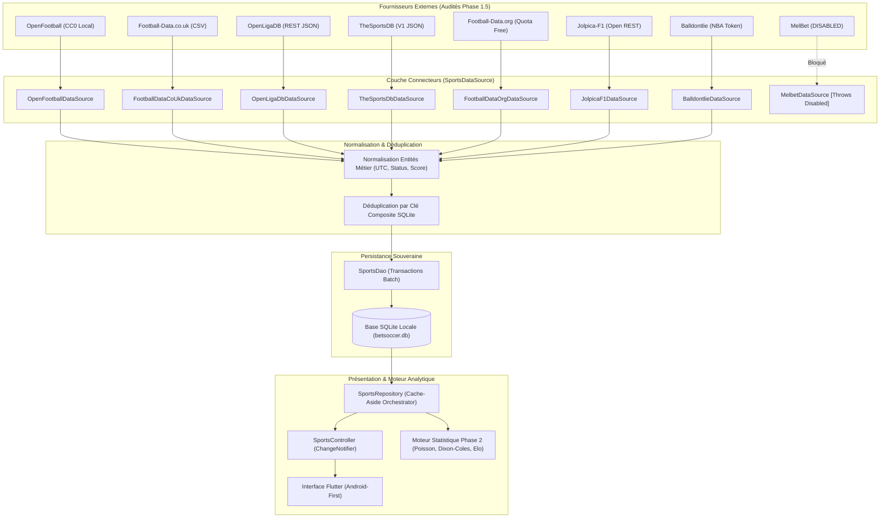

# BETSOCCER — ARCHITECTURE DE DONNÉES ET DE COLLECTE RECOMMANDÉE (PHASE 1.5)

**Date d'établissement :** 13 octobre 2026  
**Architecte :** Équipe Senior Architecture Logicielle, Intégration de Données & SQLite  
**Projet :** BETSOCCER (`com.ghdinteractivestudio.betsoccer`)

---

## 1. Principes Directeurs de l'Architecture Cible

À l'issue de l'audit de faisabilité de la Phase 1.5, l'architecture d'ingestion de données de BETSOCCER s'articule autour de 6 piliers :

1. **Souveraineté Locale & Zéro Dépendance Bloquante (Offline-First)** :  
   SQLite demeure l'unique source de vérité sportive. L'application doit pouvoir démarrer, afficher les catalogues et calculer les modèles statistiques même en l'absence totale de connexion réseau.
2. **Neutralité et Interchangeabilité des Fournisseurs** :  
   Le domaine métier ne dépend d'aucun format propriétaire externe. L'interface `SportsDataSource` fait office de passerelle d'abstraction unique.
3. **Traçabilité et Transparence des Données** :  
   Chaque enregistrement (sport, ligue, match, résultat, statistique) conserve sa source d'origine (`sourceProvider`), son identifiant amont (`sourceMatchId`) et son horodatage UTC de synchronisation (`lastSyncedAt`).
4. **Déduplication Déterministe** :  
   La fusion de flux provenant de plusieurs connecteurs (ex: OpenFootball + Football-Data.co.uk + TheSportsDB) repose sur une clé composite unique non ambiguë : `(competition_id, season_id, home_team_id, away_team_id, utc_kickoff)`.
5. **Résilience et Disjoncteur (Circuit Breaker)** :  
   Toute panne réseau, expiration de quota (HTTP 429) ou indisponibilité de serveur externe est isolée sans jamais perturber la navigation utilisateur.
6. **Stabilité du Schéma SQLite V1** :  
   L'audit démontre que le schéma V1 actuel (10 tables relationnelles créées en Phase 1) est **100% adéquat et complet** pour accueillir les flux multisports et les statistiques détaillées sans aucune migration destructive.

---

## 2. Diagramme des Flux d'Ingestion de Données



---

## 3. Spécification des Connecteurs Cibles

### 3.1 Connecteurs Prioritaires Recommandés
1. **`OpenFootballDataSource` (Existant - Phase 1)** :  
   - Rôle : Ingestion des archives historiques locales déconnectées.
   - Entités alimentées : `sports`, `competitions`, `seasons`, `teams`, `matches`, `results`.
2. **`TheSportsDbDataSource` (Existant - Phase 1)** :  
   - Rôle : Découverte multisport, blasons graphiques d'équipes et métadonnées.
   - Entités alimentées : `sports`, `competitions`, `teams` (avec logos et drapeaux).
3. **`OpenLigaDbDataSource` (À intégrer en Phase 2 / Phase 3)** :  
   - Rôle : Ingestion du calendrier allemand et multisport (Handball HBL, Volleyball VBL) et scores en direct gratuits.
   - Entités alimentées : `matches`, `results`, `goals`.
4. **`FootballDataCoUkDataSource` (À intégrer pour la Phase 2)** :  
   - Rôle : Ingestion des métriques avancées de match (tirs cadrés, corners, fautes) pour alimenter les paramètres d'intensité offensive et défensive du modèle Dixon-Coles.
   - Entités alimentées : `match_statistics` (`shots`, `shots_on_target`, `corners`, `fouls`, `cards`).
5. **`FootballDataOrgDataSource` (Existant - Phase 1)** :  
   - Rôle : Flux en direct des 12 ligues majeures sous disjoncteur 10 req/min.

### 3.2 Connecteurs Conditionnels
- **`JolpicaF1DataSource`** : Dédié exclusivement au sport automobile (courses de Formule 1).
- **`BalldontlieDataSource`** : Dédié au basketball NBA si la clé API gratuite est fournie par l'utilisateur dans les réglages.

### 3.3 Connecteurs Rejetés
- **`MelbetDataSource`** : Reste strictement verrouillé en `DISABLED_BY_POLICY`.
- **Connecteurs de Scraping HTML FlashScore / SofaScore** : Aucun collecteur HTML ne sera développé pour éviter tout blocage d'adresse IP et tout risque d'insécurité juridique.

---

## 4. Stratégie de Déduplication et de Synchronisation

### 4.1 Clé Composite de Déduplication
Chaque match inséré dans la table `matches` respecte la contrainte SQLite :
```sql
UNIQUE (competition_id, season_id, home_team_id, away_team_id, utc_kickoff)
```
Lorsqu'un match est découvert par une source secondaire (ex: TheSportsDB) alors qu'il a déjà été créé par OpenFootball :
1. `SportsDao.upsertMatches()` utilise `ConflictAlgorithm.replace` ou effectue un merge intelligent préservant les identifiants locaux.
2. Les statistiques additionnelles (ex: tirs issus de Football-Data.co.uk) viennent enrichir la table `match_statistics` liée à l'identifiant du match existant.

### 4.2 Horodatage Normalisé et Gestion du Fuseau Horaire
- Toutes les dates sont stockées au format strict **UTC ISO-8601** (`YYYY-MM-DDTHH:MM:SSZ`).
- Les dates transmises par des API locales (ex: OpenLigaDB en fuseau allemand) sont converties via `DateTime.parse(utcString).toUtc()`.
- La couche présentation se charge de l'affichage dans le fuseau local de l'utilisateur Android (`AppDateUtils.formatDisplay()`).

### 4.3 Gestion des Quotas & Disjoncteur (Circuit Breaker)
Pour protéger l'application contre les blocages HTTP 429 :
```dart
class RateLimitTracker {
  DateTime? _blockedUntil;

  bool get isBlocked => _blockedUntil != null && DateTime.now().isBefore(_blockedUntil!);

  void registerRateLimit(Duration cooldown) {
    _blockedUntil = DateTime.now().add(cooldown);
  }
}
```
Si un fournisseur signale un quota dépassé, le connecteur bascule silencieusement sur la source locale SQLite ou sur le connecteur suivant sans générer d'alerte intempestive à l'écran.

---

## 5. Évaluation du Schéma SQLite V1

L'analyse d'adéquation entre les données réelles testées (tirs, corners, fautes, buteurs, sets, mi-temps) et le schéma V1 (`lib/core/database/migrations/v1_initial_schema.dart`) confirme que :
- La table `matches` dispose de tous les champs de planification (`utc_kickoff`, `status`, `matchday`, `round_label`, `current_minute`, `is_sample_data`, `source_provider`, `last_synced_at`).
- La table `results` gère les scores finaux, mi-temps et prolongations (`home_score`, `away_score`, `home_halftime_score`, `away_halftime_score`, `winner_team_id`).
- La table `match_statistics` accueille les métriques détaillées (`category`, `name`, `home_value`, `away_value`).
- La table `sync_state` journalise l'état de fraîcheur (`key`, `provider_id`, `last_synced_at`, `records_synced`, `status`).

**Conclusion d'architecture :** **Aucune modification de rupture du schéma SQLite n'est requise**. Le schéma V1 est validé et prêt à accueillir les futures phases.
